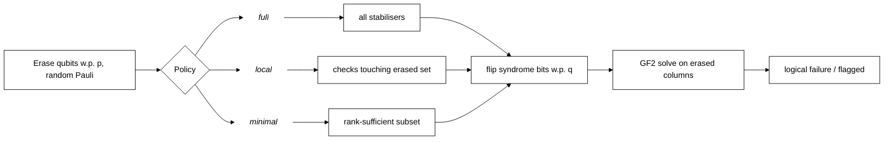
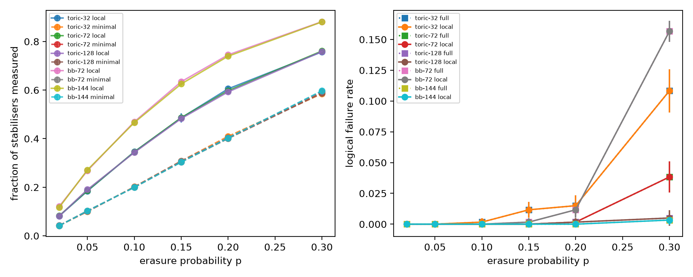
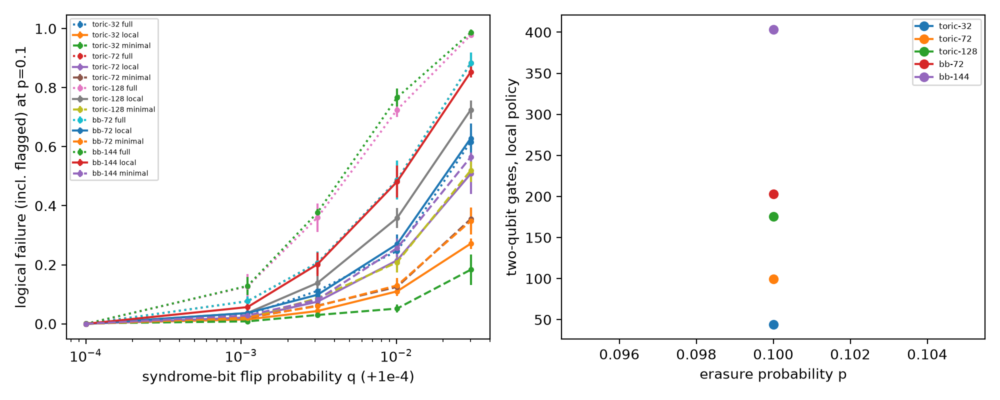

# Measurement-reduced erasure recovery on toric and bivariate bicycle codes

  

**Abstract.** When a qubit loss or leakage is flagged as an erasure, a decoder only needs the stabilisers that touch the erased qubits. This simulation study quantifies how many stabiliser measurements and syndrome-extraction controlled-NOT gates (CNOTs) that saves on toric and bivariate-bicycle (BB) codes (n = 32 to 144), and how it behaves when readout bits flip. It is a classical Galois field of two elements, GF(2) simulation; it makes no hardware or quantum-advantage claim.

## Motivation and gap
Logical-qubit experiments on superconducting and neutral-atom devices (Acharya et al., 2023, doi:10.1038/s41586-022-05434-1; Bluvstein et al., 2024, doi:10.1038/s41586-023-06927-3) and low-overhead BB codes (Bravyi et al., 2024, doi:10.1038/s41586-024-07107-7) make erasure-aware decoding relevant. Matsumoto (2027, doi:10.1007/s40314-026-03881-4) formalises that stabilisers irrelevant to erased qubits can be omitted. This repo measures the practical size of that saving per code family and under noisy syndrome bits. See `docs/RESEARCH_GAP.md` and `docs/METHOD.md`.

## Method

Three policies (`full` = standard baseline, `local`, `minimal`) are compared on paired shots; 4 seeds x 150 shots per point.

## Results (from `results/`)
Noiseless readout (`results/table_main.md`, `results/erasure_sweep_summary.csv`). Logical failure was identical for all three policies in every row:

| code | n | p | full meas | local meas (% of full) | minimal meas (% of full) | logical fail (all policies) |
|---|---|---|---|---|---|---|
| toric-32 | 32 | 0.05 | 32 | 5.9 ± 0.3 (18%) | 3.2 ± 0.2 (10%) | 0.000 ± 0.000 |
| toric-32 | 32 | 0.1 | 32 | 11.1 ± 0.3 (35%) | 6.5 ± 0.2 (20%) | 0.002 ± 0.003 |
| toric-32 | 32 | 0.2 | 32 | 19.4 ± 0.3 (61%) | 13.1 ± 0.3 (41%) | 0.015 ± 0.008 |
| toric-72 | 72 | 0.05 | 72 | 13.4 ± 0.4 (19%) | 7.2 ± 0.2 (10%) | 0.000 ± 0.000 |
| toric-72 | 72 | 0.1 | 72 | 24.9 ± 0.6 (35%) | 14.5 ± 0.4 (20%) | 0.000 ± 0.000 |
| toric-72 | 72 | 0.2 | 72 | 43.0 ± 0.7 (60%) | 29.0 ± 0.3 (40%) | 0.002 ± 0.003 |
| toric-128 | 128 | 0.05 | 128 | 24.4 ± 0.5 (19%) | 13.2 ± 0.2 (10%) | 0.000 ± 0.000 |
| toric-128 | 128 | 0.1 | 128 | 43.9 ± 0.6 (34%) | 25.5 ± 0.5 (20%) | 0.000 ± 0.000 |
| toric-128 | 128 | 0.2 | 128 | 75.9 ± 0.9 (59%) | 51.3 ± 0.9 (40%) | 0.002 ± 0.003 |
| bb-72 | 72 | 0.05 | 72 | 19.3 ± 0.5 (27%) | 7.2 ± 0.2 (10%) | 0.000 ± 0.000 |
| bb-72 | 72 | 0.1 | 72 | 33.8 ± 0.5 (47%) | 14.5 ± 0.4 (20%) | 0.000 ± 0.000 |
| bb-72 | 72 | 0.2 | 72 | 53.7 ± 0.4 (75%) | 29.1 ± 0.3 (40%) | 0.012 ± 0.006 |
| bb-144 | 144 | 0.05 | 144 | 39.1 ± 0.8 (27%) | 14.8 ± 0.3 (10%) | 0.000 ± 0.000 |
| bb-144 | 144 | 0.1 | 144 | 67.2 ± 1.0 (47%) | 28.7 ± 0.6 (20%) | 0.000 ± 0.000 |
| bb-144 | 144 | 0.2 | 144 | 106.5 ± 0.8 (74%) | 57.9 ± 0.7 (40%) | 0.000 ± 0.000 |

Syndrome-bit flips at p = 0.1 (`results/table_noise.md`, `results/measurement_noise_summary.csv`). Entries: failure rate ± std / fraction flagged as inconsistent. `minimal` failures are silent:

| code | q | full: failure/flagged | local: failure/flagged | minimal: failure (silent) |
|---|---|---|---|---|
| toric-72 | 0.001 | 0.077 ± 0.016 / 0.077 | 0.022 ± 0.018 / 0.022 | 0.020 ± 0.012 |
| toric-72 | 0.01 | 0.487 ± 0.066 / 0.487 | 0.215 ± 0.025 / 0.215 | 0.125 ± 0.023 |
| bb-72 | 0.001 | 0.077 ± 0.016 / 0.077 | 0.037 ± 0.019 / 0.037 | 0.022 ± 0.010 |
| bb-72 | 0.01 | 0.487 ± 0.066 / 0.487 | 0.270 ± 0.033 / 0.270 | 0.130 ± 0.025 |
| bb-144 | 0.001 | 0.128 ± 0.030 / 0.128 | 0.057 ± 0.016 / 0.057 | 0.028 ± 0.015 |
| bb-144 | 0.01 | 0.767 ± 0.030 / 0.767 | 0.482 ± 0.055 / 0.482 | 0.257 ± 0.032 |




## Discussion
- **H1 holds** in this simulation: `full`, `local` and `minimal` have identical logical failure in all noiseless runs (also a unit test). This follows from the linear algebra, so the contribution is the size of the saving, not a new decoder.
- **H2 holds**: at p = 0.1, `local` needs 34-35% of stabilisers on the toric code and 47% on the BB codes.
- **H3 holds**: `minimal` needs 10%, 20% and 40% of the stabilisers at p = 0.05, 0.1, 0.2 for every code, since the number of checks equals n and the rank is bounded by the erased count (about 2pn).
- **H4 holds, with a catch**: with q > 0, `local` fails less than `full` because `full` raises false alarms from checks far from the erasure. `minimal` has the lowest failure number, but those failures are silent: it gives up the consistency check.
- Logical failures are rare (0 to 0.015); I draw no conclusion about relative code performance from them.

## Limitations
Erasure-only noise with perfect gates; no circuit-level noise, hook errors or repeated rounds; a simple single-round readout-flip model; `minimal` needs the erased set before measurement and is a greedy, not optimal, subset; small statistics (600 shots per point); not tied to any device.

## Future work
Circuit-level noise with flagged leakage/loss on neutral-atom arrays, repeated rounds with measurement-error detectors, joint erasure plus Pauli errors, and an optimal minimal measurement set.

## Reproducibility
```
pip install -r requirements.txt
pytest -q
python experiments/run_all.py          # about 35 s, CPU only, 16-thread Windows 11 laptop
python experiments/run_all.py --quick  # smoke run, a few seconds
```

## Related work by the author
- [qaoa-best-of-k-sampling-noise](https://github.com/pradeepdegalaroyal/qaoa-best-of-k-sampling-noise)
- [heralded-vs-unheralded-noise-monitored-clifford](https://github.com/pradeepdegalaroyal/heralded-vs-unheralded-noise-monitored-clifford) (heralded erasure in monitored circuits)

## Structure
`src/erasure_local/` codes and decoder, `experiments/run_all.py`, `tests/`, `docs/`, `results/`, `figures/`.

## Citation

If you use this code, please cite it (see also `CITATION.cff`):

```bibtex
@software{chenchupradeep2026erasurelocal,
  author  = {Chenchupradeep, Degala},
  title   = {Measurement-reduced erasure recovery on toric and bivariate bicycle codes},
  year    = {2026},
  version = {0.1.0},
  url     = {https://github.com/pradeepdegalaroyal/erasure-local-stabiliser-measurements},
  license = {MIT}
}
```

Massachusetts Institute of Technology (MIT) license (`LICENSE`).

## License
MIT.
